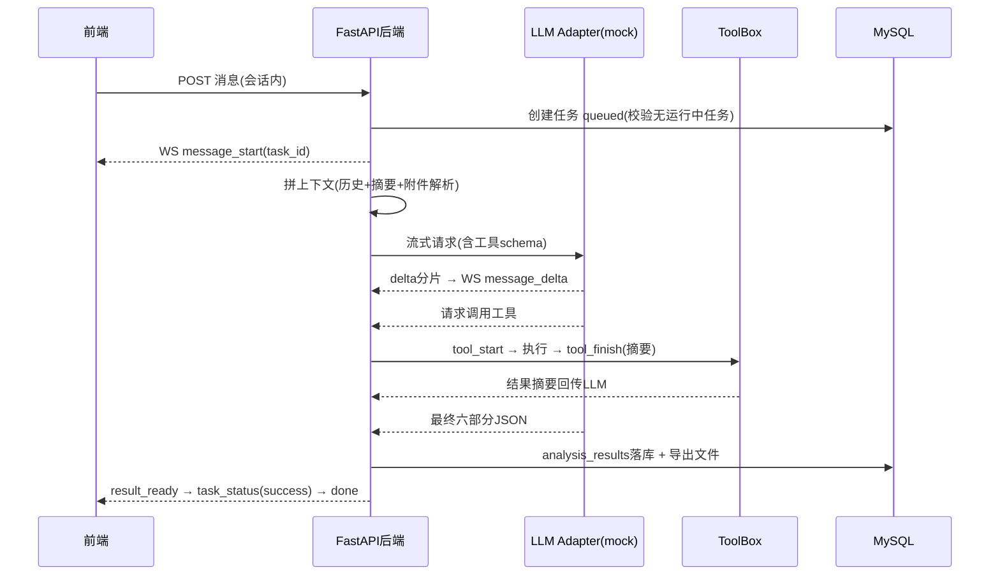

# Business_Attribution_Analysis_System 概要设计总纲

| 项 | 内容 |
|---|---|
| 版本 | v0.9（待审阅） |
| 日期 | 2026-10-24 |
| 依据 | 《Business Attribution Analysis System 需求文档》2.1 节 |
| 状态 | 技术栈四项决策已确认（见 §3），其余默认选择标注 ⚠ 待确认 |

---

## 1. 项目背景

经营分析中一个高频痛点：业务人员发现指标异常（如转化率下降、加购未下单比例升高），需要跨多张业务表反复查数、比对、排除，靠人工归因效率低、口径不一、结论难追溯。

本项目实现一个**面向经营分析场景的多轮归因分析系统**：

- 用户围绕一个业务问题在会话中**持续追问、补充资料**（上传附件、指定数据范围）；
- 系统执行**数据库查询、文件读写、文本检索、命令执行**等工具获取证据；
- 每轮输出**六部分结构化归因结论**（问题定义/关键指标/证据列表/归因结论/待补充数据/下一步建议），并生成可下载的结果文件；
- 分析过程通过 WebSocket **实时可视**（任务状态、当前步骤、工具执行过程）。

交付形式：可运行前端 + 后端 + 本地 mock 认证中心 + 数据库初始化脚本 + 示例数据 + 接口说明 + **客户行为分析、评论反馈分析两个场景的全链路演示**。

---

## 2. 项目定位与边界

- 本项目**独立交付**，与知识库管理平台无代码依赖；与舆情分析平台（需求文档 2.2）**不在本期范围**，仅共用"grill-me → PRD → 概要设计 → 分模块自底向上开发"的方法论。
- 原提示词模板中引用 `PRD_知识库管理平台.md`、"当前项目（知识库管理平台）与知识库项目的关系" 为模板残留，**本文档生效后以本文档为准**，后续提示词需同步替换为归因系统文档名。

---

## 3. 总体技术决策

| 决策项 | 选择 | 理由 / 说明 |
|---|---|---|
| 项目范围 | 仅需求 2.1 归因系统 | 已确认 |
| 后端 | Python 3.11+ / FastAPI / SQLAlchemy 2.x / Pydantic v2 | 已确认；异步友好，WS 与 LLM 流式原生支持 |
| 前端 | Vue 3 + Vite + Pinia + Element Plus | ⚠ 默认选择；PC 管理台风格，与 FastAPI 配合成熟 |
| 数据库 | MySQL 8.0（SQLAlchemy + Alembic） | ⚠ 默认选择；满足"数据库初始化脚本"要求；开发期可降级 SQLite |
| 长连接 | WebSocket（FastAPI 原生） | 需求 2.1.4/2.1.10 指定 |
| 认证 | 本地 mock 认证中心（OAuth2 授权码模式），本系统签发 JWT 会话 | 已确认；接口形状与真实认证中心一致，切换只改配置 |
| 大模型 | mock 优先 → SiliconFlow（OpenAI 兼容） | 已确认；统一走 LLM Adapter，切换=改 base_url/key/模型名 |
| 文件存储 | 本地目录 uploads/ exports/ workspace/ | 需求 2.1.8；单机演示不引入 MinIO |
| 中间件 | 无 Redis、无消息队列 | 单机会话级单任务约束下不需要；需要水平扩展时再加 |
| 部署 | Windows 本机直跑（uvicorn + vite dev / vite build） | ⚠ 默认选择；提供可选 docker-compose.yml |

服务端口约定：backend `8000`，mock_auth `9001`，mock_llm `9002`，frontend dev `5173`。

---

## 4. 模块划分

### 4.1 前端 7 模块（对齐需求 2.1.5）

| 模块 | 职责 | 主要页面/组件 |
|---|---|---|
| 认证回调模块 | 授权跳转、回调参数接收、令牌保存、登录态校验 | LoginEntry、AuthCallback、路由守卫 |
| 会话模块 | 会话列表加载、新建、删除、重命名、切换 | SessionList |
| 聊天模块 | 消息发送、流式渲染、取消分析、历史回放 | ChatPanel、MessageItem |
| 附件模块 | 上传（进度）、删除、下载 | AttachmentSidebar（抽屉） |
| 结果模块 | 六部分结构化展示、复制、导出、文件下载 | ResultPanel |
| 配置模块 | 系统配置查看、配置重载 | admin/ConfigPage |
| 日志模块 | 运行状态、错误信息查看（task_logs） | admin/LogPage |

工作台布局（需求 2.1.3）：左=会话列表；中=对话区 + 底部输入框/发送按钮；右=实时任务区（上，可折叠）+ 结果展示区（下）；附件侧栏以抽屉唤起。

### 4.2 后端 9 模块（对齐需求 2.1.6）

| 模块 | 职责 | 主要接口 |
|---|---|---|
| 认证接入模块 | 对接认证中心、令牌校验、当前用户识别 | /auth/login、/auth/callback |
| 会话模块 | 会话 CRUD、状态（active/archived/deleted）、删除级联 | /api/chat/create·delete·update·ls·ls/{id} |
| 消息模块 | 消息入库、seq_no 顺序控制、历史查询 | 随会话接口与 WS 下发 |
| 附件模块 | 保存/删除/下载、路径校验、解析状态 | /api/attachment/upload·delete·get |
| 长连接模块 | 会话级 WS、一次性 token 鉴权、推送、关闭 | /api/chat/ws-token、WS /api/chat/ws/chat |
| 任务模块 | 任务创建、状态流转、取消、日志、ws-token 签发 | /api/tasks/{task_id} |
| 分析模块 | 上下文拼装、工具调度、结构化结论生成 | 内部服务 |
| 结果模块 | 结果落库、导出文件、上下文摘要压缩 | /api/results/{task_id} |
| 配置模块 | system_configs 读取与热更新 | /api/admin/reload |

### 4.3 辅助服务 2 个（独立进程，均可一键切换为真实实现）

| 服务 | 端口 | 职责 |
|---|---|---|
| mock_auth | 9001 | 模拟 OAuth2 授权码流程：/oauth/authorize（假登录页）→ /oauth/token → /userinfo |
| mock_llm | 9002 | OpenAI chat.completions 兼容形状的流式接口，内置两场景"剧本"（工具调用+结论），后续替换为 SiliconFlow |

---

## 5. 分层架构

```
┌─────────────────────────────────────────────────────┐
│ 接入层  Vue3 SPA（登录/回调/工作台/管理页）              │
└──────────────┬──────────────────────┬───────────────┘
        REST(axios)          WebSocket(原生)
┌──────────────▼──────────────────────▼───────────────┐
│ 网关层  FastAPI：路由/依赖注入(JWT校验)/统一响应/日志     │
├─────────────────────────────────────────────────────┤
│ 服务层  会话·消息·附件·任务引擎·分析编排·结果·配置        │
│         （任务引擎 = 状态机 + WS 推送 + asyncio 取消）   │
├─────────────────────────────────────────────────────┤
│ 适配层  LLM Adapter(mock→SiliconFlow)                 │
│         ToolBox(db_query/file_ops/text_search/cmd_exec)│
│         AuthAdapter(mock_auth→真实认证中心)             │
├─────────────────────────────────────────────────────┤
│ 存储层  MySQL 8 │ 本地文件(uploads/exports/workspace)  │
│                │ task_logs(运行日志)                  │
└─────────────────────────────────────────────────────┘
     ▲ 独立进程：mock_auth:9001   mock_llm:9002
```

一轮分析的时序：



---

## 6. 关键设计

### 6.1 认证与会话

- **授权码流程**：前端入口页 → `GET /auth/login`（携带 state）302 到 mock_auth `/oauth/authorize` → 假登录表单（预置用户 tangck/admin）→ 302 回 `/auth/callback?code=...&state=...` → 后端以 code 换 token、拉取 /userinfo → `users` 表按 `external_user_id` upsert → 签发本系统 JWT（HS256，2h，含 user_id/role）→ 302 进工作台。
- **WS 鉴权**：`POST /api/chat/ws-token` 签发一次性 token（websocket_tokens 表，`expires_at`≈30s，连接成功即写 `consumed_at`，二次使用拒绝）；WS 连接参数 `websocket_token + conversation_id`，校验 token 有效且用户拥有该会话。

### 6.2 任务状态机与并发约束

```
queued ──▶ running ──▶ success
              │  ├──▶ failed
              └─────▶ cancelled   （用户点"取消分析"）
```

- 一条用户消息 = 一个 analysis_task（需求 2.1.4）。
- **单会话单运行任务**：事务内 `SELECT ... FOR UPDATE` 会话行 → 检查存在 `queued/running` 任务则拒绝（错误码 `TASK_RUNNING`）→ 创建新任务。
- **取消**：任务引擎持有 asyncio.Task 句柄；取消时置 `cancelled`，工具循环在每次执行前检查取消标志，LLM 流中断并落 `task_logs`。

### 6.3 WebSocket 消息协议（8 类，需求 2.1.10）

| type | 关键字段 | 时机 |
|---|---|---|
| message_start | task_id, conversation_id | 任务开始 |
| message_delta | task_id, delta_text | LLM 增量文本 |
| tool_start / tool_finish | task_id, tool_name(, tool_result_summary) | 工具前后 |
| task_status | task_id, task_status, current_step | 状态/步骤变化 |
| result_ready | task_id, result_id | 结构化结果落库后 |
| error | task_id, error_message | 失败 |
| done | task_id, finished_at | 本轮结束（success/failed/cancelled 都会发） |

统一信封：`{"type": "...", "data": {...}, "ts": 1698...}`。断线补偿：重连后先拉 `GET /api/tasks/{task_id}` + `GET /api/results/{task_id}` 补状态，WS 只负责增量。

### 6.4 上下文拼装与摘要压缩

- 每轮上下文 = system 提示词（含六部分输出 schema + 工具清单 + 当前会话数据源说明）+ context_summaries 中 `end_seq_no` 之前的压缩摘要 + `end_seq_no` 之后的 messages 原文 + 本会话附件解析文本（截断）。
- 触发压缩：当待发送消息总长 > 阈值（默认 8000 字符，可配置），将 `[start_seq_no, end_seq_no]` 段交给 LLM 摘要 → 写 context_summaries；摘要为 mock 时输出模板化要点。

### 6.5 工具集与安全边界

| 工具 | 能力 | 安全约束 |
|---|---|---|
| db_query | 只读 SQL 查询业务示例表 | 专用只读账号、仅 SELECT、禁止多语句、强制 LIMIT、表白名单 |
| file_read / file_write | 读写 workspace/{user_id}/{conversation_id}/ | 路径规范化后必须位于会话目录内，越界拒绝 |
| text_search | 在附件解析文本与 workspace 文件中关键词检索 | 仅限本会话目录 |
| cmd_exec | 执行受限命令（如 python 统计脚本） | 命令白名单 + 超时（默认 30s）+ 工作目录隔离 + 输出截断 |

工具结果以 `tool_result_summary`（≤500 字）回传 LLM 并推送前端；完整输出写 task_logs。

### 6.6 结构化结果（六部分，需求 2.1.11）

- `key_metrics[]`：metric_name/metric_value/metric_unit/metric_period；`evidence_list[]`：source_type/source_name/evidence_text/related_metric/confidence。
- LLM 输出强制 JSON Schema 校验（Pydantic）；`下一步建议` ≥2 条校验。
- 落库 `analysis_results` 六个独立列 + `result_markdown`（渲染模板）+ `result_file_path`（`exports/{user_id}/{conversation_id}/{task_id}.md`）。

### 6.7 配置热更新

- system_configs 按 config_group 分组（llm / tool / analysis / ws / auth）。
- 后端内存缓存带 version；`POST /api/admin/reload` 清缓存重载，响应 `{status, message}`；前端配置页展示当前值与重载按钮。关键键：`llm.provider`、`llm.base_url`、`llm.model`、`tool.db_query.dsn`、`tool.cmd.whitelist`、`analysis.max_tool_calls`、`analysis.context_threshold`、`ws.token_ttl`。

### 6.8 LLM Adapter（mock→真模型切换点）

```python
class LLMClient(Protocol):
    async def stream_chat(self, messages, tools) -> AsyncIterator[Event]  # Delta | ToolCall | Final
```

- mock_client：按问题关键词匹配两场景剧本，产出固定节奏的 delta 分片、1–2 次工具调用、最终六部分 JSON——保证不接真模型时全链路可演示。
- openai_client：OpenAI 兼容（SiliconFlow base_url）。切换仅改 system_configs（llm.*）+ 重载，代码零改动。

---

## 7. 数据存储与中间件

### 7.1 MySQL：10 张业务表（对齐需求 2.1.7）+ 8 张演示业务表

| 表 | 用途 | 关键索引 |
|---|---|---|
| users | 用户 upsert、角色 | unique(external_user_id) |
| conversations | 会话与状态 | (user_id, status), last_message_at |
| messages | 消息流，seq_no 会话内自增 | unique(conversation_id, seq_no) |
| attachments | 附件与解析状态 | (conversation_id) |
| analysis_tasks | 任务状态机 | (conversation_id, task_status), (user_id) |
| analysis_results | 六部分结果 + markdown + 文件路径 | unique(task_id) |
| context_summaries | 摘要压缩段 | (conversation_id, end_seq_no) |
| websocket_tokens | 一次性 WS 令牌 | unique(token), expires_at |
| system_configs | 配置与热更新 | unique(config_key) |
| task_logs | 工具执行/错误日志 | (task_id, created_at) |

删除会话（软删 status=deleted 前置校验后物理清理）：级联删 messages/attachments/analysis_tasks/analysis_results/context_summaries/websocket_tokens/task_logs + 删除 uploads/exports/workspace 三个目录。

### 7.2 演示示例数据（seed 脚本生成，数据里"埋了可归因的模式"）

| 场景 | 表 | 埋点示例 |
|---|---|---|
| 客户行为分析 | biz_user, biz_visit_event, biz_add_cart_event, biz_order_event | 近两周"移动端新访客"转化率从 8% 跌至 3%（某类目详情页改版所致） |
| 评论反馈分析 | biz_comment, biz_rating, biz_product, biz_refund | 某商品批次差评集中、评分下滑，且与退款原因"质量问题"强相关 |

### 7.3 文件目录（需求 2.1.8）

```
{backend}/uploads/{user_id}/{conversation_id}/    附件
{backend}/exports/{user_id}/{conversation_id}/    导出结果
{backend}/workspace/{user_id}/{conversation_id}/  分析中间文件
```

---

## 8. 后端框架与目录约定（FastAPI）

分层：api(路由) → services(业务) → repositories(SQL查询) → models(SQLAlchemy)；schemas(Pydantic) 隔离出入参；core 承载横切面。

```
backend/
├── app/
│   ├── main.py                 # FastAPI 工厂、路由注册、异常处理
│   ├── core/                   # config.py(热更新缓存) security.py(JWT) deps.py deps_ws.py errors.py logging.py
│   ├── api/                    # auth.py chat.py attachment.py tasks.py results.py admin.py ws.py
│   ├── services/               # conversation.py message.py attachment.py task_engine.py
│   │                           # analysis.py(编排) context_builder.py result.py summary.py
│   ├── llm/                    # base.py mock_client.py openai_client.py prompts.py
│   ├── tools/                  # base.py db_query.py file_ops.py text_search.py cmd_exec.py
│   ├── models/                 # 10 张表 SQLAlchemy 模型
│   ├── schemas/                # Pydantic 模型(含六部分结果 schema)
│   └── db/                     # session.py alembic/
├── sql/                        # 01_init.sql(10表) 02_seed_customer.sql 03_seed_review.sql
├── tests/                      # 按模块 pytest(状态机/路径校验/摘要触发为必测)
├── mock_auth/                  # 独立 FastAPI 应用(9001)
├── mock_llm/                   # 独立 FastAPI 应用(9002)
├── uploads/ exports/ workspace/  # 运行时生成，.gitignore
├── requirements.txt  pyproject.toml  .env.example  run_all.bat
└── docker-compose.yml          # 可选：mysql + backend + frontend
```

约定：统一响应包 `{code, message, data}`；业务错误码 AUTH_xxx / CONV_xxx / TASK_xxx / FILE_xxx；日志 struct 风格（task_id 贯穿）；附件路径校验、任务状态流转必须走 services 层函数，api 层禁止直查 DB。

---

## 9. 前端框架与目录约定（Vue 3）

```
frontend/src/
├── api/            # request.ts(axios+JWT拦截) auth.ts chat.ts attachment.ts task.ts result.ts admin.ts
├── stores/         # auth.ts conversation.ts chat.ts attachment.ts task.ts config.ts (Pinia)
├── router/         # /login /auth/callback /workbench /admin/config /admin/logs + 守卫
├── composables/    # useWebSocket(重连/心跳/补状态) useStreamRender(delta累积)
├── components/     # SessionList ChatPanel MessageItem AttachmentSidebar TaskPanel ResultPanel
└── views/          # LoginEntry AuthCallback Workbench admin/ConfigPage admin/LogPage
```

关键交互：WS `message_delta` 按 task_id 累积进当前消息气泡；`tool_start/finish` 渲染为任务区时间线；取消按钮调任务模块取消接口；结果区"导出"= 下载 result_file_path 文件，"复制"= 剪贴板 markdown。

---

## 10. 演示链路设计（两场景）

每场景预置 3 轮追问脚本，验证"多轮追问 + 补充证据 + 阶段性结论"：

| 场景 | 轮次示例 | 预期归因路径 |
|---|---|---|
| 客户行为分析 | ①近30天下单转化率如何？→②哪个人群/入口跌了？→③结合上传的改版说明附件，主因是什么 | db_query 访问/加购/下单 → 分组对比定位移动端新访客 → file_read 附件佐证 → 结论+建议 |
| 评论反馈分析 | ①近30天商品评分如何？→②差评集中在哪些商品/原因？→③退款数据和评论能否互相印证 | db_query 评分/评论 → 聚类定位批次 → db_query 退款交叉验证 → 结论+建议 |

验收以需求 2.1.13 八条逐条打勾为准（登录/会话附件消息/实时过程/历史追问/六部分结果/导出重下/配置热更/两场景演示）。

---

## 11. 里程碑（自底向上，每阶段验证通过再进下一阶段）

| # | 阶段 | 内容 | 验收门槛 |
|---|---|---|---|
| 0 | 文档修正与骨架 | 修提示词残留、建仓库、目录、环境确认 | 目录就绪，uvicorn/vite 可起空页 |
| 1 | PRD | grill-me 问透后按模板生成 doc/1_PRD | 覆盖需求 2.1.1–2.1.13 全条目 |
| 2 | 地基 | 10 表 DDL+模型、mock_auth、mock_llm、run_all | curl 走通授权码全流程；mock LLM 可流式 |
| 3 | 认证登录闭环 | /auth/*、users、前端登录两页+守卫 | 浏览器：入口→认证中心→回调→工作台空壳 |
| 4 | 会话/消息/附件 | 会话 CRUD 级联删、消息 seq_no、附件三接口+目录 | 建/删/传/下载全通，删会话目录同步消失 |
| 5 | 任务引擎与 WS | ws-token、8 类消息、状态机、取消、task_logs | mock 剧本轮次 8 类消息全出现，取消生效 |
| 6 | 分析引擎与结果 | 上下文拼装+摘要压缩、4 工具、六部分落库导出 | 一轮产出六部分结果并导出重下载 |
| 7 | 管理页 | 配置页+热更新、日志页、数据源连接管理 | 改 llm 配置→reload→即时生效 |
| 8 | 两场景演示 | seed 数据、演示脚本、全链路跑通 | 2.1.13 八条全绿 |
| 9 | 接真模型与收尾 | SiliconFlow 切换、接口说明、执行过程学习总结 | 真模型下两场景复跑通过 |

每模块沿用 CLAUDE.md 五步法：数据对象 → 原型图（HTML 静态页替代 .pen）→ spec 文档 → 后端程序 → 前端程序，产出存 `doc/3_开发文档/{模块}/`。

---

## 12. 风险与对策

| 风险 | 对策 |
|---|---|
| mock 与真模型行为差异大，切真后提示词/工具 schema 失效 | Adapter 接口从第一天对齐 OpenAI 形状；阶段 9 预留复跑与提示词调优 |
| cmd_exec 被滥用 | 白名单+超时+目录隔离+输出截断，管理员可配置 |
| WS 断线丢消息 | 一次性 token 重签 + `GET /api/tasks`/`GET /api/results` 补偿回查 |
| 删除会话误删 | 后端先校验归属+软删标记，物理清理放独立事务与目录删除 |
| Windows 路径/编码坑 | 统一 pathlib + utf-8，目录分隔符不出现在接口返回中（file_path 一律正斜杠） |
| 单会话并发任务 | DB 事务行锁 + services 层唯一入口，杜绝绕过 |

---

## 13. 待审阅确认项汇总

1. 前端 Vue3 + Element Plus（⚠ 默认，可换 React/AntD）
2. MySQL 8.0（⚠ 默认，开发期可降级 SQLite）
3. 演示数据"埋雷"策略与两场景三轮追问脚本（§10）
4. mock_auth 预置用户与角色（tangck=分析用户 / admin=系统管理员）
5. 里程碑排期粒度（§11）是否按此推进
